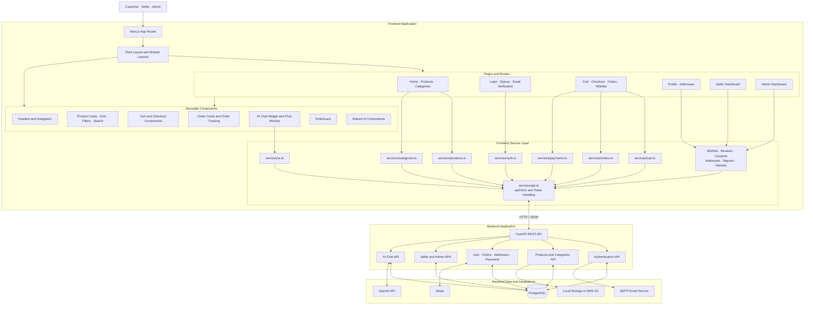

# ShopSphere — Frontend Architecture

ShopSphere is an AI-powered multi-vendor e-commerce platform built with Next.js, React, TypeScript, and Tailwind CSS. The frontend provides shopping functionality for customers and management portals for sellers and administrators.

## Architecture Diagram



## 1. Frontend Technology Stack

- Framework: Next.js 16
- UI library: React 19
- Language: TypeScript
- Styling: Tailwind CSS 4
- Routing: Next.js App Router
- Icons: Lucide React
- Alerts: SweetAlert2
- Payment UI integration: Stripe.js and React Stripe.js
- Shared UI components: Project UI components and Shadcn-related tooling

## 2. Application Routes

### Public and Shopping Routes

- `/` — Home page
- `/products` — Product listing
- `/products/[id]` — Product details
- `/categories/[id]` — Category products
- `/cart` — Shopping cart
- `/checkout` — Checkout
- `/wishlist` — Wishlist
- `/orders` — Customer orders
- `/orders/[id]` — Order details and tracking
- `/profile` — User profile
- `/addresses` — Address management

### Authentication Routes

These routes are located under the `app/(auth)` route group:

- `/login`
- `/signup`
- `/forgot-password`
- `/reset-password`
- `/privacy`
- `/terms`

The `(auth)` directory is a Next.js route group. Its name does not appear in the browser URL.

### Seller Routes

- `/seller/dashboard`
- `/seller/dashboard/products`
- `/seller/dashboard/inventory`
- `/seller/dashboard/orders`
- `/seller/dashboard/shipments`
- `/seller/dashboard/analytics`
- `/seller/dashboard/revenue`
- `/seller/dashboard/profile`

### Administrator Routes

- `/admin/dashboard`
- `/admin/dashboard/users`
- `/admin/dashboard/products`
- `/admin/dashboard/categories`
- `/admin/dashboard/coupons`
- `/admin/dashboard/reports`
- `/admin/dashboard/ai-conversations`
- `/admin/dashboard/profile`

## 3. Component Architecture

Reusable components are organized under `components/`.

- `components/auth/` — Role-based route guard
- `components/ai-chat/` — AI chat widget, window, messages, and input
- `components/cart/` — Cart item and cart summary
- `components/checkout/` — Checkout form
- `components/layout/` — Headers, footer, navigation, and sidebar
- `components/orders/` — Order cards and order tracking
- `components/products/` — Product cards, filters, grid, and search
- `components/ui/` — Reusable UI controls

The root layout is defined in `app/layout.tsx`. Seller and administrator layouts are defined separately in their respective route directories.

## 4. API Service Layer

The `services/` directory separates frontend API operations from page components.

- `api.ts` — Shared API request handling, authorization headers, and token refresh logic
- `auth.ts` — Signup, login, verification, profile, and authentication operations
- `products.ts` — Product operations
- `categories.ts` — Category operations
- `cart.ts` — Cart operations
- `orders.ts` — Order operations
- `addresses.ts` — Address operations
- `payments.ts` — Payment operations
- `wishlist.ts` — Wishlist operations
- `reviews.ts` — Product reviews
- `coupons.ts` — Coupon operations
- `reports.ts` — Reporting operations
- `adminUsers.ts` — Administrator user operations
- `product-options.ts` — Product option operations
- `product-variants.ts` — Product variant operations
- `product-variant-images.ts` — Variant image operations
- `ai.ts` — AI chat API operations

## 5. Authentication and API Requests

The shared API client is implemented in `services/api.ts`.

- The API base URL can use `NEXT_PUBLIC_API_URL`.
- The local fallback URL is `http://127.0.0.1:8000`.
- API requests use the shared `apiFetch` function.
- The API client handles access tokens and refresh-token requests.
- Authentication operations are organized in `services/auth.ts`.
- `components/auth/RoleGuard.tsx` provides role-based guarding functionality.

Authentication and authorization must also be enforced by the backend. Frontend route guards alone are not sufficient to secure protected data or operations.

## 6. Backend Integration

The frontend communicates with the FastAPI backend over HTTP using JSON requests and responses where applicable.

The backend provides the API operations used for authentication, products, categories, cart, orders, payments, reviews, and other platform features.

The backend is responsible for database access, server-side validation, permissions, and external service integrations.

## 7. Environment Configuration

The frontend API client supports:

- `NEXT_PUBLIC_API_URL` — Optional environment variable for the backend API base URL
- `http://127.0.0.1:8000` — Local API fallback defined in `services/api.ts`

Configure the production API URL in the frontend deployment environment. Do not expose secret backend credentials through `NEXT_PUBLIC_` variables.

## 8. Verification Notes

- Frontend routes were identified from the project's `app/` directory.
- Reusable components were identified from `components/`.
- API service modules were identified from `services/`.
- The shared API client and token-handling implementation were identified in `services/api.ts`.
- The frontend dependencies were identified from `package.json`.
- Backend integration is represented at the architectural level. Individual routes, permissions, payment flows, and AI interactions should be verified against the implementation and tested end to end.

This document describes the frontend structure and its intended interactions with the backend. The diagram does not imply that every feature or integration has passed end-to-end testing.
```

## Step 2: Validate the document

After saving with `Ctrl + O`, `Enter`, and `Ctrl + X`, run:

```bash
git diff --check
git status --short
```

If `git diff --check` prints nothing, there are no whitespace errors in the tracked changes. Since this is a new file, `git status --short` should show it as untracked, similar to `?? docs/frontend-architecture.md`.

**Important:** The diagram is based on the routes, components, and services you listed. Its connections describe the intended architecture; they do not prove every page calls the particular service shown. We can verify those connections next if you want the diagram to represent every implementation detail precisely.